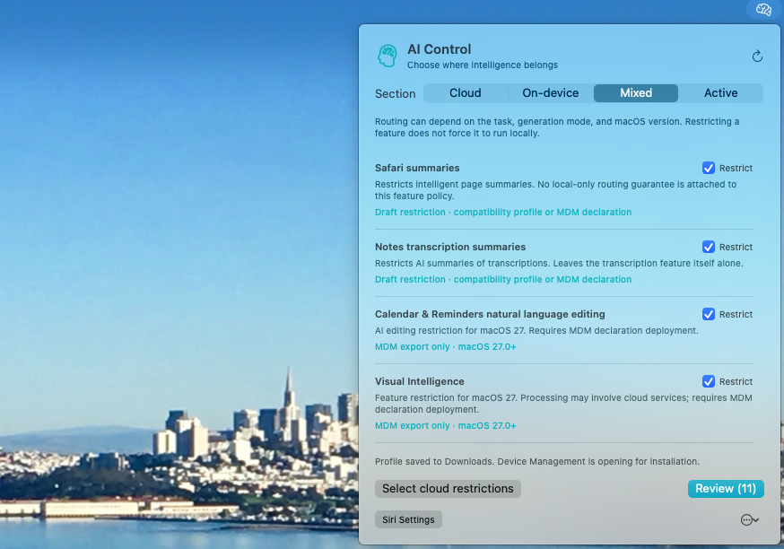
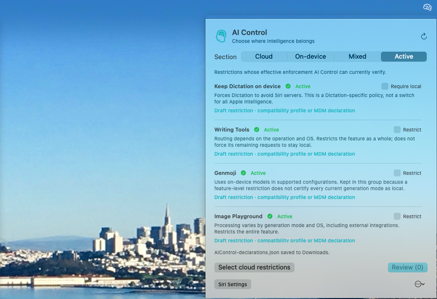

# AI Control

A native macOS menu bar app focused on controlling macOS AI features. The app separates cloud integrations, on-device capabilities, and features with mixed or Apple-managed routing sections. The Active section shows matching readable effective settings.

Why I created this app is I understand why people do not want AI to take over their computer without their consent. I also recognize that AI can be useful in situations. This app is not about being anti-AI but about giving you choice and control rather than an all or nothing approach.

AI Control was initially conceived as a Swift Dialog application utilizing checkboxes to generate a configuration profile. However, after working on it and realizing the need for additional features, such as activation section and reviewing another github project, this project pivoted towards development of a menu bar application that distinguishes between cloud-based and on-device AI functionalities.

## Download the app

App downloads are available through **[GitHub Releases](https://github.com/ecubrooks/macos-admin-laboratory/releases)**.

1. Choose the AI Control release and check its notes for the required macOS version and processor architecture.
2. Under **Assets**, download the app ZIP or installer package provided with that release. GitHub's automatically generated **Source code** archives contain the project source.
3. For a ZIP, extract it and move **AI Control.app** to **Applications**. For a PKG, open it and follow the installer instructions.
4. Open the app and click its brain icon in the menu bar.

Release downloads are signed with a Developer ID certificate.

Installing a configuration profile still requires separate approval in System Settings. DDM JSON exports require deployment through a supporting MDM; opening the app does not automatically install those declarations.

## Requirements and compatibility

The project targets macOS 14 or later. **The app has been tested on macOS 26 and macOS 27.** Earlier versions have not been confirmed by this testing.

Feature controls are gated by their minimum macOS version. Apple Intelligence requires eligible hardware, language, region, and account configuration; OS eligibility in the app does not certify feature availability.

The app uses SwiftUI `MenuBarExtra`, stays out of the Dock, and has no main window. It has no third-party package dependencies.

The app was developed in Xcode with Codex (the irony of using AI in Xcode to build a tool that blocks AI isn’t lost on me).

## Controls

| Section | Features | Behavior |
| --- | --- | --- |
| Cloud | External AI integrations, external AI account sign-in, on-device-only Dictation | Select policy restrictions, then review and export/install a compatibility profile or export MDM declarations |
| Cloud | Private Cloud Compute | Explains routing; no unsupported global PCC toggle |
| On-device | Inline text predictions | Change this user’s preference directly; restore its original value or absence |
| On-device | Foundation Models framework, Xcode predictive completion | Information-only entries; no undocumented disable or asset deletion |
| Mixed / Apple-managed | Siri AI, Writing Tools, Genmoji, Image Playground, Mail, Safari, Notes, Calendar/Reminders, Visual Intelligence | Select feature restrictions; newer controls require MDM declaration deployment |

The cloud preset selects supported external AI restrictions and requires local Dictation. **It is not an “all AI stays local” mode.** 

## Applying and undoing Restrictions

Policy checkboxes represent a **draft**. Review the selected restrictions before generating an output. Unchecked features are omitted rather than explicitly enabled. The Active section separately shows restrictions whose effective values the app can verify.

- **Configuration profiles:** Use Apple's legacy `com.apple.applicationaccess` keys, "deprecated" in macOS 26.4. They can be exported or opened for manual approval in System Settings. Validate behavior on the target macOS. Remove the `AI Control` profile in System Settings to release its restrictions. Organizational policies can still prohibit a feature.
- **MDM declarations:** Preferred management format for macOS 26.4+. The exported JSON contains configurations and an activation. It is not an installable profile without a supporting MDM. Publish the individual declarations through a supporting MDM. Siri AI, Visual Intelligence, and Calendar/Reminders editing require macOS 27+. Removing or replacing their declarations through MDM releases these restrictions.

The app does not automatically install profiles, deploy MDM declarations, override organization settings, or claim applied status from a generated file. Active status requires a matching readable effective value: forced legacy restrictions in `com.apple.applicationaccess`, or the disabled inline-prediction preference. A disabled preference appears as Active, the app does not test behavior inside every app. Restart affected apps if needed.  DDM-only restrictions remain unverifiable without an MDM status source. It intentionally leaves Apple Intelligence Reports available. Manual Mail summaries and automatic previews are different: the legacy manual-summary restriction does not disable automatic summaries.

## Compatibility and future updates

The current compatibility-profile approach is retained for this version. Many of its Apple Intelligence restriction keys are deprecated starting in macOS 26.4. Deprecation in itself does not establish a removal or guarantee continued behavior: verify each restriction on the macOS versions you deploy, including after updates. Installing a profile successfully does not by itself prove every setting is enforced.

The app exports MDM declarations, but it does not deploy them or obtain MDM status. These capabilities are not currently planned.

## Screenshots

### Selected restrictions

### Readable active settings

The Active view reports matching readable settings and can include restrictions applied by other profiles or management tools. It does not identify which profile has the setting. 

## Sources

Reviewed October 16, 2026 (UTC):

- [RemoveMacAI](https://github.com/omlahore/RemoveMacAI), reference commit `2e974cf796d5748ab5d6f2bccc9679d708ec6e2b`.
- [Apple device-management](https://github.com/apple/device-management), reference commit `09f249a06e7e3289930bf6d05f38fb562f748ebf`.
- [Intelligence settings](https://github.com/apple/device-management/blob/release/declarative/declarations/configurations/intelligence.settings.yaml).
- [External intelligence settings](https://github.com/apple/device-management/blob/release/declarative/declarations/configurations/external-intelligence.settings.yaml).
- [Siri settings](https://github.com/apple/device-management/blob/release/declarative/declarations/configurations/siri.settings.yaml).
- [Legacy restrictions](https://github.com/apple/device-management/blob/release/mdm/profiles/com.apple.applicationaccess.yaml).
- [Apple Intelligence and privacy](https://support.apple.com/guide/mac-help/mchlfc0d4779/mac).
- [Foundation Models](https://developer.apple.com/documentation/foundationmodels).
