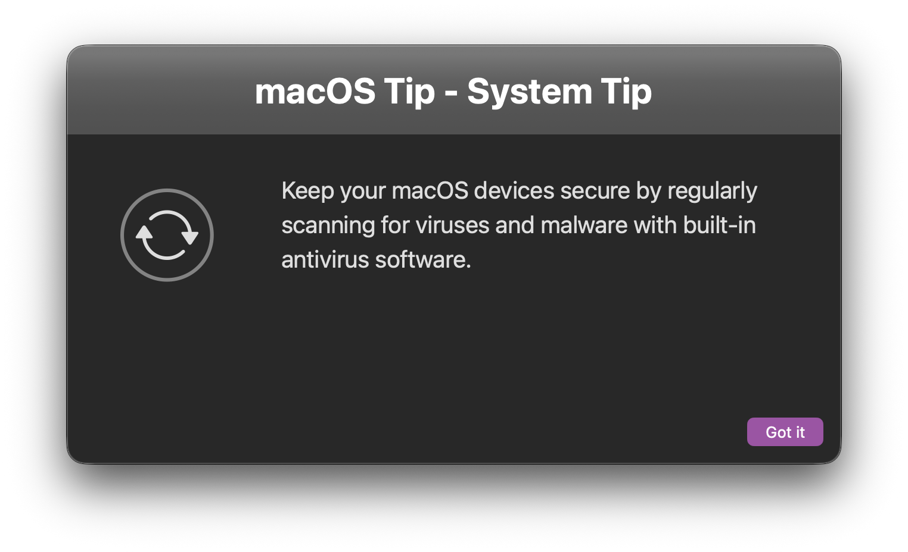

# macOS Tip AI Dialog

A concept script how Apple Intelligence can fit into admin workflows.  Leverages SwiftDialog and Apple Intelligence framework to display random macOS tips to users

## Concept Overview

This is more of a **concept / experiment** than a production-ready tool and was built to explore what’s possible. Combining AI with other tools.

* The Swift portion was **generated with AI assistance** and adjusted for this workflow
* Output is **nondeterministic** and may not always be perfect
* Keyword matching for UI changes is simple to show you can match output to change tasks.

---

## What It Does

* zsh script calls a Swift script to generate a macOS tip
* Falls back to a static tip if needed
* Adjusts dialog UI based on keywords:
  * Icon (SF Symbols)
  * Banner title
  * Banner color
* Displays everything using SwiftDialog and changes the view dynamically to match keywords




---

## Requirements

* macOS 26+ (Apple Intelligence support)
* SwiftDialog (`/usr/local/bin/dialog`)
* Swift (default macOS install)

---

## Setup

Place the Swift AI in readable location:

```
/Library/Application Support/Swift/macos-tip-ai.swift
```

Make scripts executable:

```
chmod +x macos-tip-dialog.sh
chmod +x "/Library/Application Support/Swift/macos-tip-ai.swift"
```

---

## Usage

Run manually:

``` 
zsh ./macos-tip-dialog.sh
```

