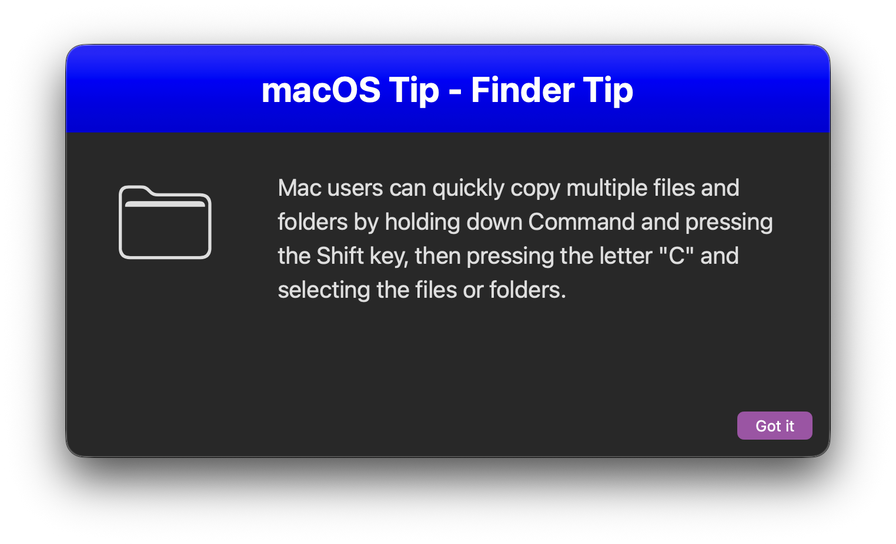
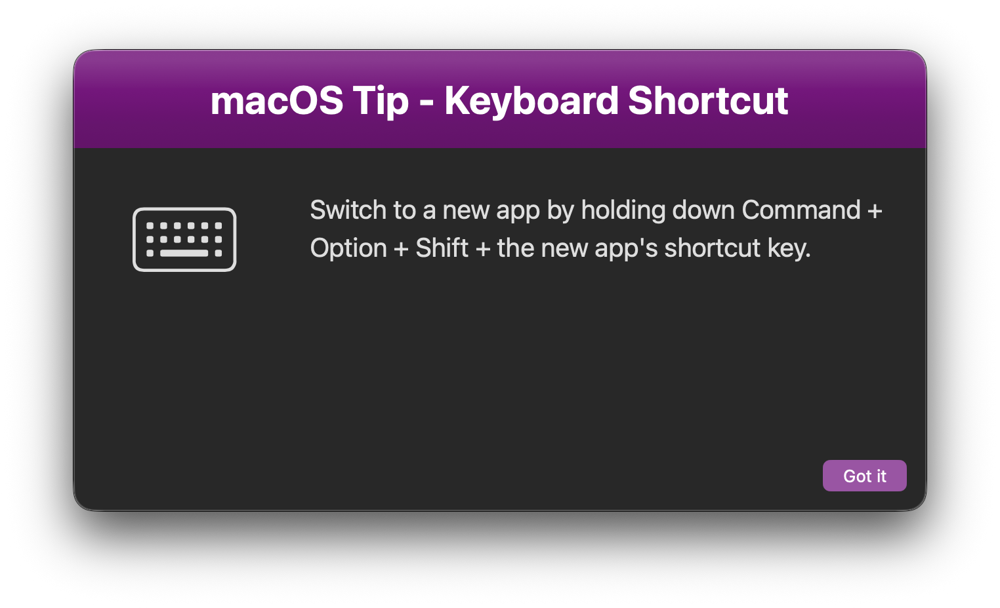

# macOS Tip AI Dialog

A concept script how Apple Intelligence can fit into mac admin workflows.  I uses the [Apple Foundation Models](https://developer.apple.com/documentation/foundationmodels) `fm` command-line tool or swift with Apple Intelligence framework and SwiftDialog to display random macOS tips to users.

## Concept Overview

This is more of a **concept / experiment** than a production-ready tool and was built to explore what’s possible. Combining AI with other tools.

* The **fm** command-line tool requires macOS 27.x and uses Apple’s on-device Foundation Model.
* Output is **nondeterministic** and may not always be perfect
* Keyword matching for UI changes is simple to show you can match output to change tasks.
* Swift script method can be used as an optional fallback on Macs with Xcode or the Xcode Command Line Tools installed or unapproved **fm** usage.

---

## What It Does

* zsh script calls a **fm** cli or Swift script to generate a macOS tip
* Falls back to a static tip if needed
* Adjusts dialog UI based on keywords:
  * Icon (SF Symbols)
  * Banner title
  * Banner color
* Displays everything using SwiftDialog and changes the view dynamically to match keywords





---

## Requirements

* mac with Apple Intelligence support
* macOS 27.x (`/usr/local/bin/fm`)
* SwiftDialog (`/usr/local/bin/dialog`)
* Swift (XCode Command Lines tool install)

---

## Setup

If using the Swift, place the Swift AI in readable location:

```
/Library/Application Support/Swift/macos-tip-ai.swift
```

Make script executable:

```
chmod +x macos-tip-dialog.sh
```
The Swift script only needs to be readable.

---

## Usage

Run manually:

``` 
zsh ./macos-tip-dialog.sh
```

The script accepts the Foundation Models license when required, generates a tip using **fm**, and uses the swift if that method for xgeneration is unavailable.